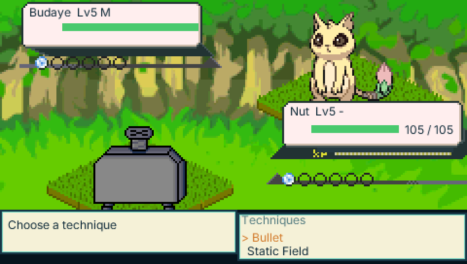
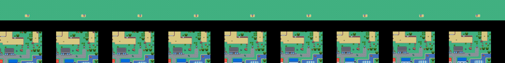
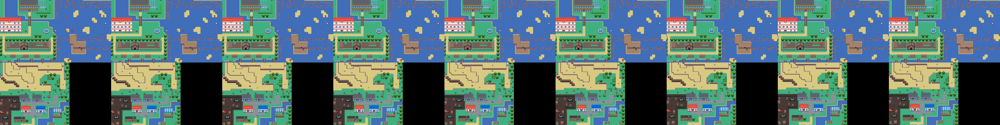
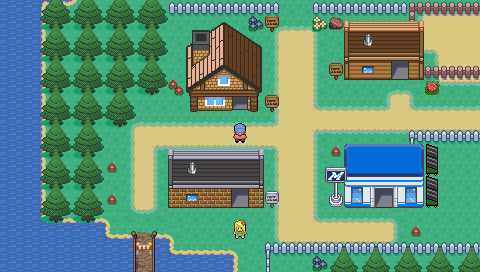
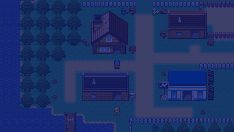

# Pocket Tuxemon

[Tuxemon](https://github.com/Tuxemon/Tuxemon)'s world — its maps, events,
characters and dialogue — imported into
[Pocket RPG Kit](https://github.com/lfkdsk/pocketjs-rpgkit) and played on
[PocketJS](https://github.com/pocket-nexus/pocketjs) (desktop, web, PSP).

Work in progress. The importer reads a pinned Tuxemon checkout
(`bun run fetch:tuxemon`, commit `9e6258ff`) and writes
`rpgkit-project/v1` documents and baked art into this repository.

<p align="center">
  
  
</p>

## Status

The per-system checklist is in [docs/status.md](docs/status.md); the
summary:

- **World (P1, playable):** all 263 Tuxemon maps and their 4,572 events are
  imported automatically — terrain with one-way ledges, animated tiles, tall
  NPC walkers, dialogue, cutscene routes and map transfers. The Spyder
  campaign plays from the bedroom through Paper Town, Cotton Town, City Park,
  the north end of Route 3, Route 4 and Flower City to the Captain's return
  in the Mansion and on through Candy Town, the hospital cure and Omnichannel
  Radio Tower broadcast, then across Routes E and B to the Data Center and
  Kernel's defeat — the complete 230,322-frame Spyder mainline at 60 Hz,
  driven by
  deterministic autoplay tapes — and every imported input lock is executed
  to its unlock. On the 67 placed outdoor maps, the streamed renderer paints
  neighbouring ground, upper layers and animated tiles across authored seams,
  with map, texture-shard and NPC-art caches bounded to the current world
  working set. The project now opts into `seamless-v1`: all 258
  coordinate-preserving outdoor openings plus all 75 lanes of 25
  fixed-destination openings cross atomically in eight ticks with no fade
  (283 portal IDs total). Upstream funnels each of those wide openings to one
  fixed landing; here every lane lands on the neighbour cell beside it. 65
  wholly legacy outdoor portals (surf-only water openings, layout gaps, story
  and same-map teleports), plus indoor and faint transfers, keep their legacy
  transition.
  Neighbouring maps preview statically decidable
  NPCs, and a completed handoff saves a frozen snapshot of the map just left
  so actors behind the player do not jump back to their entry poses. Static
  canopies and animated upper tiles interleave by row with active, preview and
  frozen actors using Tuxemon's two-pixel foot rule, including across seams.
- **Battles (P2, complete):** the battle database and 590 battle
  textures are imported from Tuxemon's YAML, and `battle/` is a pure
  reducer whose results match Tuxemon's own Python engine on 8,560 recorded
  battles; monsters spawn draw-for-draw like Tuxemon's. The mainline is
  played for real end to end: the autoplay tapes fight 216 player battles
  (111 on the Route 3 mainline — 22 trainer + 89 wild — 16 on the
  Captain-return continuation — 10 trainer + 6 wild — and 57 on the way to
  the hospital cure — 50 trainer + 7 wild — and 15 through Omnichannel and
  the Radio Tower — 13 trainer + 2 wild — and 17 on the Kernel quest —
  12 trainer + 5 wild), and every trainer
  battle enters Battle Processing and ends `won` with its `battle_outcome`
  written back. The frozen 32-minute 60 Hz tape (116,107 frames / 32 min 15 s)
  replays byte-identical at 60, 30 and 20 Hz, and both failure paths are
  verified — the first loss against Billie, and a later loss on Route 3
  with the faint-point teleport, the heal-before-leaving block and the
  nurse recovery. Double battles, capture, items, swapping and levelling
  are live. The battle scene uses the imported Tuxemon backgrounds,
  islands, trainers, monsters, HUD frames, status/party icons and
  technique strips; every slide, hit, HP/XP tween, faint and capture shake
  is driven by the reducer's rewindable reference tick rather than a wall
  clock. The 590 images are indexed single-tile entries, loaded on demand
  through one battle cache and detached/freed on exit.
- **Names and Tuxepedia:** the authored player- and monster-name prompts use
  saved, rewindable game scenes. Player prompts offer Tuxemon's gender-selected
  deterministic random-name pools; the same imported action also supports NPC
  targets, whose runtime names are visible through subsequent character-name
  dialogue tokens. Seen/caught status is persistent and monotonic;
  journal previews and the normal browser render monster details through the
  same indexed, lazily loaded battle-image shards as combat.
- **Performance:** each language uses 260 compact map shards plus 3 canonical
  JSON shards, occupying 5,348,762 B for English and 5,582,139 B for Chinese.
  The three event-heavy
  maps cross a 128 KiB compact-decode cap, trading a small amount of storage
  for bounded first-visit latency on QuickJS. Indexed battle art plus its lazy
  database occupies 3,516,960 B in the pak. The current seven-language Web
  source pak is 136,356,304 B. It publishes an English base as a 6,586,991 B
  gzip startup pack plus 2,124 deferred chunks (29,315,968 B gzip); a
  non-English boot fetches only its selected 208,194–220,173 B locale
  bootstrap. The source includes the locale content, CJK font atlases, all
  content-resolvable audio, its attribution list and demo data. The desktop
  launcher keeps render-critical textures, fonts and the three small WAV
  effects in its 37,855,968 B startup pak. It moves 2,951 lazy data entries
  (21,161,642 B) and the 24 QOA music entries (22,481,712 B) to the companion
  `dist/runtime-data` tree without changing their keys. QOA files are copied
  from `data.fs` one 64 KiB page per frame before playback starts; maps,
  battle data and the other lazy documents use their existing on-demand
  readers. The fully minified desktop JavaScript is 1,388,507 B.
  Before compact
  maps and indexed battle art, an earlier English-only Web build was
  66,791,328 B. The all-image battle encoding is
  2,206,076 B on disk and 13,394,688 B if every PSM_T8 texture were decoded,
  but only the active battle working set is resident.

  Native desktop releases now keep the final source bundle as a fallback and
  add target-matched QuickJS bytecode. A fixed-CPU comparison used ten
  alternating ABBA/BAAB windows per viewport, with 20 fresh processes per side.
  At 480×272, source-only and bytecode medians were 224.483 and 108.916 ms;
  at 960×544 they were 227.493 and 109.118 ms. The paired improvements were
  51.62% and 51.81%, and the bytecode worst cases were 110.894 and 112.971 ms,
  meeting both the 150 ms median target and 250 ms hard limit. The 45,564,952 B
  package is 6,316,560 B larger than its source-only form because it retains
  the 1,390,793 B source section beside a 6,316,531 B bytecode envelope. Web
  remains source-only. See [the bytecode report](findings/G23-BYTECODE.md) for
  native measurements and [the earlier startup report](findings/G21-STARTUP.md)
  for the source-minification and browser-loading history.

  On the desktop QuickJS host, the fixed-CPU journey matrix starts fresh
  processes per route and viewport. Under one-minute loads of 1.30–4.89, all
  completed GB6, hospital-to-radio J3 and two-pass outdoor-cache production
  frames stayed below the stricter 45 ms line; the worst QuickJS-plus-core CPU
  frame was 42.287 ms. That is 0.199 ms below the previous five-run maximum and
  0.371 ms above its three-run review maximum. Every cache-walk sample had zero
  second-pass native-node or texture growth. Shared-host startup remains
  unreliable: the unchanged 250 ms gate rejected both five-process GB6 groups
  before replay and four of five J3 480×272 starts, so separately labelled
  500 ms startup diagnostics supplied those production-frame distributions
  without being counted as startup passes. A separate post-merge closure ran
  five fresh short-English G6 and Chinese-smoke processes at each viewport with
  the default limits: all 20 passed, with 209.961 ms as the largest startup and
  32.787 ms as the largest production frame. Two same-core/storage-contention
  attempts failed startup at 308.911 and 282.272 ms and remain recorded; they
  do not change the longer GB6/J3 limitation above. A dedicated Cotton Town
  short-window gate now preserves the preceding outdoor-cache allocation
  history while avoiding a full mainline replay. Its latest three-process
  runs at each viewport stayed at or below 15.046 ms (480×272) and 16.045 ms
  (960×544), against a 45 ms limit. Cold/hot medians, exact startup counts,
  load ranges, bundle identities and attribution are in
  [the verification guide](docs/verification.md#the-quickjs-benches).
- **Import coverage:** 96.3% of Tuxemon action uses and 97.2% of condition
  uses map natively to kit commands; 98.0% / 97.5% are executable (native,
  degraded, or a deliberate placeholder). The full per-type breakdown is in
  [reports/G1-coverage.md](reports/G1-coverage.md).
- **Day/night:** a saved, rewindable calendar drives Tuxemon's time conditions
  and its real day/night event pages. Fresh games start from one local-clock
  sample; tests and journey replays pin 09:00. Dawn, day, dusk and night use a
  smoothly changing named tint, while weather has its own deterministic RNG
  and transition deadline.

## Screenshots

The world renders pixel-for-pixel like Tuxemon's own maps. Left: this
runtime; right: an independent render of the same Tuxemon TMX map, used as
the reference in the terrain tests (0 differing pixels).


Imported dialogue placement is visible at both supported viewport sizes: the
Maple flashback uses 0.8W×0.25H left/right corner windows, and its Chinese long
line continues onto a second page instead of clipping. See the
[480×272 and 960×544 captures](docs/screenshots/dialog-layout/).

The first trainer battle, played for real: Billie's Budaye against Nut,
with sprites, HUD and backgrounds imported from Tuxemon and the rules
running bit-exact with Tuxemon's own engine. The lower band is Pocket RPG
Kit's state-driven command/list UI; the screenshot is a nearest-neighbour
2× capture of its 480×272 logical scene.

<p align="center">
  
</p>

The mainline journey, played by the deterministic autoplay tape: Cotton Town
(left) and the north end of Route 3 (right), two frames from the Route 3
mainline.

<p align="center">
  
  
</p>

Safe outdoor openings now scroll directly into the neighbouring map. The two
contact sheets below show all eight crossing phases plus the landing frame for
a horizontal and vertical seam; each row is also captured at both supported
viewports in [docs/screenshots/world-seam](docs/screenshots/world-seam/).

<p align="center">
  
  
</p>

The same Paper Town checkpoint at fixed 09:00 and 21:00 starts. The night
frame is intentionally darker and bluer; the golden test verifies those
properties from the decoded pixels as well as pinning the PNG bytes.

<p align="center">
  
  
</p>

## Play it

- **In a browser:** <https://lfkdsk.github.io/pocketjs-tuxemon/pocket-tuxemon/>
  (deployed from `main` after CI has played the opening browser journey on it).
- **From a CI run:** every push builds the web version. Open the
  latest [CI run](../../actions/workflows/ci.yml), download the `web-site`
  artifact, unzip it and serve the folder, e.g.
  `python3 -m http.server -d web-site 8000`, then open
  <http://localhost:8000/pocket-tuxemon/>.
- **Locally:** `bun run web`, then serve `dist/web` the same way; or
  `bun run desktop` for the desktop host.
- **Browser keys:** arrows walk, `A`/`Z`/`Enter` talks and confirms, `B`/`Esc`
  goes back, `Space` (START) opens the world menu, and `L`/`Q` rewinds three
  seconds.
- **Desktop-host keys:** arrows walk, `X`/`Backspace` talks and confirms,
  `Z`/`Enter` goes back, `A` is SQUARE, `S` is TRIANGLE, `Space` is START,
  and `L`/`Q` rewinds. A host regression test pins this legacy desktop map.

### Install and play offline

After the browser reaches the first map, the **Offline play / 离线游玩** panel
appears below the player. Choose one content language and press **Download or
resume / 下载或继续**. The panel reports the complete package size and progress;
you can pause it, and an interrupted download resumes from the chunks already
verified in browser storage when the connection returns. If you change the
language selector while a package is downloading, that verified download
finishes first; the new selection becomes the language for the next download.

Chrome shows **Install / 安装** when its install prompt is available. You can
also install Pocket Tuxemon from the browser's app menu. Installation and the
service worker require HTTPS, except that browsers also allow `localhost` for
local development. Once cached, the game page, saves and downloaded areas work
after an offline reload. Entering an area that was not downloaded keeps the
current transition parked and opens a bilingual dialog: reconnect and retry,
or return to the cached game. Battle and expedition replay pages and Link
Battle deliberately remain outside the offline cache.

### Saving and loading

Press START (`Space` in the browser and on desktop) to open the world menu,
then choose **Save** or **Load**. The world is paused while the menu is open.

- **Save to slot / Load from slot:** three slots. The desktop build writes
  `save/slot-1.json` … `save/slot-3.json` in the app's data folder. The browser
  build keeps them in the page's local storage.
- **Automatic Save:** a read-only slot separate from the three manual slots.
  The six imported story commands write `save/autosave.json` on desktop, an
  app-scoped local-storage key in the browser, and `save/autosave.json` on
  the PSP memory stick; loading resumes immediately after the autosave
  command. A recoverable command tick, including one with a text, choices
  or shop modal, is published immediately; an unrecoverable tick such as an
  active transfer, battle or scene is deferred to the first safe reference
  tick. Focused reducer/host tests cover all six authored boundaries, the
  maintained production tape crosses four of them once, and `verify:psp:save`
  crosses the Paper Town point under PPSSPPHeadless and restarts into it.
  A missing automatic save is omitted; a storage read error stays visible as
  a damaged Automatic Save row and reports a load failure when selected.
- **Save code (export) / Load code (import):** the same save as URL-safe text,
  paged on screen. Every target keeps these two rows as a fallback. Codes are
  compressed, but still a few thousand characters
  (3,740–5,644 at the `verify:save` code points; 3,657 in the documented screenshot),
  so they suit copying between tools more than typing on the on-screen
  keyboard. Additive project-schema upgrades change the encoded text, but the
  runtime accepts compatible older schema identities and rewrites the next
  save under the current identity.

You can save manually only when nothing is in progress. During dialogue, a
battle, a scripted scene, a map change or a step, the menu says why it can't save.
Damaged saves, saves from another build of the game and empty slots show an
error and leave the game as it was. A load picks up exactly where the save was
made; `bun run verify:save` checks this at five points along the GB6 mainline.

Screens: [menu](docs/screenshots/save/save-menu.480x272.png),
[saved](docs/screenshots/save/save-done.480x272.png),
[refused](docs/screenshots/save/save-refused.480x272.png),
[loaded](docs/screenshots/save/save-loaded.480x272.png),
[save code](docs/screenshots/save/save-code-export.480x272.png)
(960×544 versions alongside; `bun run screens:save` re-renders them from the
built game).

CI also plays the 3,500-frame opening journey — bedroom, Paper Town, the
first battle, Route 1 — in headless Chrome against the built site
(`bun tools/verify-web-journey.ts`) and checks every checkpoint's state and
pixels against the goldens.

## German, French, Spanish, Italian, and Portuguese

The game imports Tuxemon's `de_DE`, `fr_FR`, `es_ES`, `it_IT`, and `pt_BR`
community catalogs. These translations are intentionally marked partial:
exact coverage of the 4,321 English-backed keys used by this port is 20.27%,
37.38%, 24.28%, 24.58%, and 20.18%, respectively. Empty, fuzzy, placeholder-
incompatible, and authored-newline-incompatible entries fall back to English;
the generated locale reports list every fallback and rejected key.

- **Web:** use `?lang=de`, `fr`, `es`, `it`, or `pt-br`. URL selection wins
  over the saved choice; otherwise the browser's preferred language is used
  before English. Options (or **R**) opens the seven-language switcher and the
  saved choice survives reloads.
- **Desktop:** pass `--lang en|zh|de|fr|es|it|pt-BR`. The same in-game choice
  is persisted in the app data folder and takes effect after restart.
- **PSP:** pass `--lang=<en|zh|de|fr|es|it|pt-BR>`. The selected locale is a
  build-time choice because this target has no locale persistence channel.

All five Latin locales share Inter's OFL-licensed glyph coverage and a
generated character inventory. Locale data is split into separate Web chunks,
so adding languages does not add them all to the startup download. See the
[locale acceptance report](findings/G25-LOCALES.md) for coverage, screenshots,
fallback accounting, package measurements, and the German full-mainline replay.

## Chinese version (中文版)

The game ships with a Simplified Chinese (zh_CN) build alongside English.
Text is resolved from the reviewed corrections in
`l10n/zh_CN/overrides.po`, then the upstream Tuxemon zh_CN community catalog,
the project's machine-translated supplement (`l10n/zh_CN/supplement.po`), two
importer labels, and finally the English source. Every one of the 5,370 English
strings has a Chinese rendering. The complete 2,098-entry upstream review is
recorded in `l10n/zh_CN/upstream-review.jsonl`; corrections retain their review
category, reason and the exact English source snapshot. Punctuation is
normalized to Chinese convention next to CJK text. The Noto Sans CJK subset
covering exactly the characters the Chinese build uses — catalog text, the
runtime resolver tables (map descriptions, battle names) and the game-drawn
strings — is baked into the font atlases at build time.

The English and Chinese project and battle shells are raw pak entries rather
than JavaScript literals. The Chinese battle-name table, map descriptions and
month names use the same mechanism. Web and console builds read the selected
entries from the pak, while desktop stages the same keys in `data.fs`; they are
decoded, parsed and cached once for the selected language. An English boot
does not read or parse any of the five Chinese-only documents. Chinese map shards use the same
128 KiB compact-decode cap as English, so the three oversized event-heavy maps
are stored as canonical JSON in both languages.

- **Web:** open the player with `?lang=zh`
  (<https://lfkdsk.github.io/pocketjs-tuxemon/pocket-tuxemon/?lang=zh>), or
  press **R** in the game to open the language switcher. The choice is
  remembered in the browser, and the page reloads without the `lang`
  parameter so the stored choice wins on the next boot (priority: URL
  parameter > stored choice > browser preference > English).
- **Desktop:** `bun run desktop -- --lang zh` (or `--lang en`). The in-game
  **R** switcher writes the choice to the app's data folder and asks for a
  restart.
- **Default:** English. The Chinese project supplies all 85 kit-owned
  interface strings: button hints, shop chrome, save pages and their
  success/failure/loading results, name input and
  its on-screen keyboard actions, demo chrome and errors, the event-error
  screen, and battle HP values. Missing future kit keys fail the importer
  instead of silently falling back to English. Game content — dialogue,
  choices, items, monsters, moves, battle menus, storage and daycare scenes
  — uses the separate Chinese catalog described above.

Saves record the language they were written with. Loading a save from a
different language shows a localized language-mismatch prompt
(which language the save is in, how to switch) before any content check,
instead of an "another build" error. The demo menu (SELECT), the chapter
buttons and Autoplay work in Chinese too. The Chinese build replays its own
tape and restores its own chapter saves: `bun run record:zh:tape` folds the
English mainline in an English and a Chinese session side by side, keeps the
English masks outside dialog boxes, rewrites only the confirm presses a
Chinese box needs (an extra page, a shorter or longer page; none are needed
today), and saves each chapter from the Chinese session on the same frame as
the English chapter (`data/zh-mainline-journey.json`,
`data/chapters.zh_CN.json`, titles in `l10n/zh_CN/chapter-titles.json`).
Both sessions must hold the same state apart from their words at every
chapter, after every dialog and at the end, so a Chinese chapter never mixes
in English event text. `bun run verify:zh:tape` re-derives both files and
fails as soon as an English tape frame changes; `bun run verify:zh:demo`
boots the built game in Chinese and checks every chapter jump, Autoplay from
three chapters (`--autoplay=all`, `--full` for the whole tape) and the Chinese
chapter thumbnails. Only the bedroom thumbnail shows words, so it alone has a
Chinese copy (`docs/screenshots/chapters-zh_CN/`). If the English tape changes
and the Chinese one is not re-recorded, the import leaves the Chinese build
without chapters (SELECT stays dormant there) rather than ship a tape that
falls out of step. The Chinese
opening has its own short smoke tape (`data/zh-smoke-journey.json`),
replayed in headless Chrome by `bun run verify:web:zh`, which renders the
expected text from the baked font atlas and matches its glyph mask against
the screenshot (dialog lines, battle prompt and command labels), asserts
strict catalog-exact pagination, and runs a mutation suite
(`tools/verify-web-zh-mutants.ts`) proving each assertion catches the
regression it targets.
`bun run check:l10n` validates every catalog layer, correction annotation,
placeholder and escaped newline, and enforces the glossary against the final
merged text (with reasoned, key-specific exceptions). `bun run check:cjk`
verifies glyph subset coverage. `bun test tests/ui-text-zh-visual.test.ts`
boots the production bundle and pins the save menu, Chinese save-success and
save-failure pages, keyboard, demo, shop, button-hint, event-error and
battle-status frames at 480×272 and 960×544, including Chinese glyph-mask
checks. The generator also writes uncommitted nearest-neighbour 3× review
copies under `dist/ui-text-zh-review/`. The demo menu capture lists the Chinese
chapter titles.

Known limitations:
- Dynamic dialog templates resolve at runtime. The importer maps Tuxemon's
  `${{var:X}}` to the kit's `{v:v.X}` variable token and its
  `${{today}}`, `${{map_desc}}`, `${{monster_0_name}}`, `${{monster_0_level}}`
  and `${{money_formatted}}` templates to `{x:}` tokens answered by the
  game's resolver (`battle/text-tokens.ts`): the date comes from the
  deterministic in-session clock, the map description from the importer's
  `dist/map-descriptions(.zh_CN).json` table, the lead monster's name and
  level from the party, and money with Tuxemon's `$`-width-4 format. The
  project declares `system.textVariables` and the `system.textTokens`
  allowlist. The only `???` left are upstream's own 2 literal
  anonymous-speaker lines (`???: ...` in cotton_town), which the Chinese
  build renders with full-width punctuation; `tests/placeholder-parity.test.ts`
  pins both. Imported cathedral flows write `scoop_price`, `party_lost_hp`,
  `cathedral_share_full`, and `cathedral_interest_full` before displaying
  them; if any variable is read before its scenario action runs, the kit's
  unset-variable default is `0`.
- The battle menu is localized: root commands (Fight/Item/Forfeit/…), the
  technique/item/party submenus, monster names, and the battle narration all
  render in Chinese from the generated `data/battle-names.zh_CN.json` table.
  Map names on the welcome sign fall back to their slug when the catalog has
  no entry.
- **PSP ships every supported locale.** `bun run build:psp:zh` remains the
  compatibility spelling for `bun run build:psp --lang=zh` (see the
  [PSP](#psp) section below). The Chinese package keeps the zh_CN
  shards and the five Chinese startup documents and emits `font-archive.bin`,
  a 2bpp CJK glyph archive (~1.1 MiB, 2,645 chars × 6 strikes) the PSP reads
  on demand from the memory stick, capped at 256 resident glyphs per slot
  across six slots (~67 KiB). Without the archive installed on the memory
  stick every CJK glyph renders as tofu (the PSP section gives the path).
  Language is a build-time choice on PSP — no localStorage or data.fs to
  persist a switch — so the in-game language switcher stays hidden there.

## Web demo controls

The game has an in-game demo menu (**SELECT**) with three pages. The web
player's **Demo controls** panel below the game covers chapters and autoplay;
map warp is in the in-game menu, or use a `?map=` link (below).

- **Chapters** — twenty buttons from the new-game bedroom to the completed
  Kernel quest. Click one (or pick it in the menu) to restore that save and
  keep playing from there, without reloading the page. The active chapter
  stays highlighted.
- **Map warp** — jump to any of the 263 imported maps. Maps with a safe
  spawn (245 of them) land on a standable, event-free cell; the eighteen
  maps with no such cell are listed but show a visible error if picked.
- **Autoplay** — play the chapter's tape suffix automatically at 1×, 2× or
  4×. Any button takes over live play; **L** rewinds three seconds.

### Eclipse Park

Eclipse Park sits outside the Spyder campaign, so use **SELECT → Map warp →
`eclipse_park_entrance`** to reach its safe `(4,3)` spawn. On the web, the
equivalent link is `?map=eclipse_park_entrance&x=4&y=3`. Walk to the reception
counter, face down and accept the 500-gold admission: that authored entrance
flow gives you 25 Park Balls, starts the 500-step counter and transfers you
into the park. Warping straight to `eclipse_park` is useful for map browsing,
but deliberately does not start a complete park session.

Wild encounters inside the paid session use the dedicated **Ball / Food /
Doll / Run** menu. Ball attempts consume a Park Ball and either catch the
Tuxemon or let it break free; Run always leaves that encounter. Food and Doll
remain visible but disabled because the pinned Tuxemon version contains only
unfinished scaffolding for them. Leaving the park or reaching the step limit
shows a bilingual session summary, then returns you to the entrance. The
menus and summary support controller, keyboard and scaled touch.

The same actions are available as deep links, so a specific scene can be
bookmarked or shared:

- `?chapter=<id>` — restore a chapter for live play (e.g. `?chapter=kernel-defeated`)
- `?map=<id>&x=<tile>&y=<tile>` — warp to a map (e.g. `?map=spyder_cotton_town&x=16&y=17`)
- `?autoplay=<id>&speed=<1|2|4>` — start a chapter on autoplay (e.g. `?autoplay=starter&speed=2`)

An invalid id (e.g. `?chapter=missing`) is a visible `BAD DEMO LINK` error,
not a crash. Chapter snapshots and the nibble-dictionary tape are packed into
the pak and read on demand, so the JS bundle keeps only a tiny chapter index;
the tape is decoded once, on the first chapter selection, and every chapter
plays a window of it. The committed chapter pack and all twenty thumbnails are
rebaked against the current 230,322-frame recording; every chapter envelope
passes decode, map-aware restore and suffix replay to the production terminal.
`bun tools/verify-web-demo.ts` drives all of the above in headless Chrome,
including a 600-frame autoplay that must reach a state byte-identical to a
reducer-level suffix replay, and checks that each chapter click repaints the
canvas with the new scene.

## Headless Arena and battle replays

`battle/arena.ts` exposes the production battle reducer as a deterministic,
JSON-only match API. A match uses a 64-character hexadecimal seed, supports
single or double battles, and can put an external agent or a built-in seeded
AI on either side. The AI side uses the same five title-battle team recipes,
from `beginner` through `expert`.

```ts
import {
  createArenaBattle,
  defaultAction,
  observe,
  replay,
  stateHash,
  submit,
  tape,
} from "./battle/arena.ts";

let battle = createArenaBattle({
  seed: "0123456789abcdef".repeat(4),
  format: "single",
  sides: [{ kind: "agent" }, { kind: "agent" }],
});

const first = submit(battle, 0, defaultAction(battle, 0));
if (!first.ok) throw new Error(first.error);
// The authoritative reducer has not advanced: side 1 has not submitted.
const second = submit(first.battle, 1, defaultAction(first.battle, 1));
if (!second.ok) throw new Error(second.error);
battle = second.battle;

const recording = tape(battle);
const verified = replay(JSON.parse(JSON.stringify(recording)));
console.log(observe(verified, 0), stateHash(verified));
```

`observe(battle, side)` is the only player-facing projection. It includes the
side's complete party, the opponent's active monsters and revealed moves, and
the exact `legalActions` for the next decision. It never includes the seed,
RNG cursors, pending actions, or the opponent's reserve party. `submit`
accepts only a value-equal member of `legalActions`; malformed, duplicate,
late, or out-of-range submissions return a stable error without changing the
input state. For two agent sides, one submission stays private until the
other arrives. The current trainer Arena has no inventory and does not permit
escape, so item and run actions are accepted only if a future configuration
actually advertises them as legal.

Matches stop after at most 2,048 paired decisions. Observations publish a
1,800-tick service deadline, and `defaultAction` provides the deterministic
timeout choice. `tape` records only complete action pairs and refuses an
unpaired agent submission. Version-1 tapes contain the normalized seed,
configuration, optional team rules, and action pairs; `replay` validates the
entire schema and reproduces the canonical state and SHA-256 state hash. A
future battle-data or rules change that alters replay semantics must advance
the tape version.

An agent side may carry persistent `team` records. `validateTeam` and battle
creation replay each acquisition, experience award, derived level and move,
TM, training item and experience item, then recompute stats and enforce the
supplied level, size and ban rules; claimed derived values are never trusted.
Storage-aware callers set `requiredKind: "expedition"` or `"legacy"` so a
record cannot silently switch validation contracts. Expedition records include
a canonical provenance checksum and globally ordered root transactions, so
accidental or partial edits are rejected. The checksum is not a signature.
Ownership and record class are caller boundaries: services must load records
from authenticated storage for that player, not accept an agent's inline
provenance as proof of ownership.

The deterministic CLI example plays a random legal-action agent against the
normal AI and prints one JSON object containing `tape`, `result`, and
`stateHash`:

```sh
bun run arena:demo
bun run arena:demo -- --seed=0123456789abcdef0123456789abcdef0123456789abcdef0123456789abcdef
```

## Server-stepped expeditions

`battle/expedition.ts` is a deterministic acquisition and training reducer for
programs and agents. The service keeps the authoritative `Expedition` value,
sends only `observeExpedition(expedition)` to the player, and accepts one
value-equal member of `legalExpeditionActions(expedition)` at a time:

```ts
import {
  applyExpeditionAction,
  createExpedition,
  legalExpeditionActions,
  observeExpedition,
} from "./battle/expedition.ts";

let expedition = createExpedition({
  seed: "0123456789abcdef".repeat(4),
  rules: { cycle: "ranked", stepBudget: 40 },
});

const observation = observeExpedition(expedition);
const action = legalExpeditionActions(expedition)
  .find((candidate) => candidate.type === "explore")!;
const applied = applyExpeditionAction(expedition, action);
if (!applied.ok) throw new Error(applied.error);
expedition = applied.expedition;
console.log(observation.area, observeExpedition(expedition).encounter);
```

Travel and exploration use a connected eight-area Spyder route network and
the imported encounter rows for the active area. Encounters support manual or
automatic Arena combat, capture devices through the production capture
formula, and fleeing. Outside encounters, legal actions cover real item
effects and move eligibility, authored shop prices and finite stock, healing,
travel and voluntary completion. Battle experience, level thresholds,
level-up moves, TMs and training items append exact step-numbered provenance.
Arena's reward result supplies the complete damage-contributor divisor and
each living winner's real experience, training points and bond gain; zero-XP
max-level rewards are retained. Use
`validateTeam(team, { requiredKind: "expedition" })` to rebuild the result
before it can enter Arena. The configured level cap applies to both persistent
party records and generated wild opponents because both enter the same
validated Arena battle. An area whose encounter rows all start above that cap
still permits travel and voluntary completion but does not advertise an
exploration action it cannot resolve.

A caught monster keeps the generated individual, capture-time HP, actual
device, captured acquisition type, capture-time persistent condition and the
wild encounter's experience-rate modifier. New provenance binds that modifier
to a real row in the recorded encounter table and uses it for later battle and
item experience. Records written before that field existed remain valid and
retain their historical 1x rate; they are not silently reinterpreted.
Capture-device refunds and all five warm-taste balls follow the production
capture transaction; mutable burn/poison state then travels separately from
immutable acquisition provenance and can be cleared by real restore/heal
actions. The pinned upstream `tuxeball_candy` success effect raises instead of
capturing because it writes a read-only level, so that one broken device is
not advertised as a legal expedition action.

Every accepted action consumes one step and advances its sequence exactly
once. Repeating an old sequence or skipping ahead is rejected without changing
the state. Before any action field is read, the reducer copies it through a
small depth-, node-, key- and string-bounded plain-data envelope; accessors,
hidden fields, symbols, cycles and oversized inputs are rejected. Before and
after every transition the reducer checks one exact, bounded canonical-JSON
state envelope: version, rules, area, terminal state, action budget, RNG
cursor/draw count, contiguous provenance sequence, cross-team root
transactions, shop/heal receipts, and inventory/money conservation. The
observation omits the seed, RNG cursor, future encounter, ledgers and
provenance. There is intentionally no expedition restore, rewind or replay
API for the authoritative state. These checks detect malformed and partially
rewritten state; they are not a cryptographic authenticator. The service must
keep the full state private in authenticated storage and commit each accepted
result atomically. Client-supplied state is never trusted.

`cycle: "ranked"` always starts from the configured fixed initial state.
`cycle: "persistent"` may start a fresh budget from an ended persistent state;
the service supplies the prior authoritative value through `continuation` with
a fresh seed, and can lower or retain a configured level cap but cannot accept
an invalid team. A voluntary or budget ending carries current HP and persistent
status forward. A defeated continuation follows Tuxemon's blackout recovery:
the party is fully healed, persistent status is cleared, the current abstract
region is retained because expeditions have no tile-level faint point, and no
money or item penalty is invented.

### Public expedition journals and replay

`battle/expedition-journal.ts` defines the strict, seedless
`pocket-tuxemon/expedition-journal/v1` presentation format. Its public rules
contain only the cycle, step budget, level cap and starting area. A journal then
stores the initial `observeExpedition` result and one `{ step, action,
observation }` entry for every accepted action. Version 1 encodes the first
observation in full, canonical sparse changes thereafter, and a full checkpoint
every 64 actions. `validateExpeditionJournal` strictly rejects unknown fields,
versions, gaps, non-canonical deltas and action/observation sequence mismatches;
on success it returns every entry with its complete observation reconstructed.
It validates only the bounded presentation format, linkage, delta
reconstruction and size limits; it does not replay or enforce game rules. A
forged but internally consistent observation—for example, a monster level that
rises without a legal reward—can pass format validation. Journal credibility
therefore comes from the service that publishes it, not from the format
validator. `startExpeditionJournal` and `appendExpeditionJournal` create
immutable encoded journals. The hard limits are 10,000 entries and 64 MiB of
encoded UTF-8 JSON.

A journal emitted from accepted service transitions contains only public
actions and fields already returned by `observeExpedition`. In particular it
has no seed, RNG state, provenance, private ledger, future encounter or hidden
battle reserve. Resolved captures add a bounded public receipt (device,
monster, shake count and outcome), while resolved battles add the public
post-turn Arena observations needed to show moves and HP changes. Such a
journal is safe to publish as a spectator record, but it is not an
authoritative save or proof that a service accepted the actions. Persistent
continuation still requires the service's private ended state and a fresh
seed; future encounters come from that new seed, not from the published
journal.

The end-to-end CLI chooses a deterministic random legal policy. When its first
cycle is defeated, it derives a fresh seed and runs a second persistent cycle,
then validates the final team, enters a normal Arena match, validates the
battle tape, and prints one JSON recording with both cycle summaries:

```sh
bun run expedition:demo
bun run expedition:demo -- --seed=0123456789abcdef0123456789abcdef0123456789abcdef0123456789abcdef
bun run expedition:demo -- --journal-out=expedition-journal.json
```

`--journal-out` writes the final expedition cycle as a directly replayable
journal. The printed demo recording also includes the journal for every cycle.

The Web build adds `expedition-replay.html` as a separate entry and pak; the
ordinary game startup does not request either. Give it a journal through
`expeditionReplay`:

```text
expedition-replay.html?expeditionReplay=expeditions/example.json
expedition-replay.html?lang=zh&expeditionReplay=expeditions/example.json
expedition-replay.html?expeditionReplay=https%3A%2F%2Fexample.org%2Fexpedition.json&expeditionReplayExternal=1
```

The English/Chinese page draws the eight-area route and travelled path, the
current exploration, capture, battle, shop, healing, item or move event, and
the current team, bag, money and remaining steps. Automatic battle actions
expand into their recorded public turns. Controls provide play/pause, one-frame
steps, timeline seeking and 1×/2×/4× playback. The source may be a bounded
`data:application/json` value, a same-origin relative HTTP(S) path, or an
explicitly enabled cross-origin HTTPS URL. External requests omit credentials;
redirects, MIME type, UTF-8, the 64 MiB limit and the complete journal schema
are checked before playback. Journal fields are data, never HTML or script.

The Web build adds `replay.html`, whose battle code and pak are separate from
the ordinary game startup. Give it a tape through `battleReplay`:

```text
replay.html?battleReplay=matches/example.json
replay.html?lang=zh&battleReplay=matches/example.json
replay.html?battleReplay=https%3A%2F%2Fexample.org%2Fmatch.json&battleReplayExternal=1
```

The page accepts either the existing raw `BattleTape` or a strict
`tux-link-replay` envelope. Sources may be bounded `data:application/json`, a
same-origin relative HTTP(S) path, or an explicitly enabled cross-origin HTTPS
URL. External requests omit credentials; redirects, final response URL, MIME
type, UTF-8, the 4 MiB limit, identity-bearing fields and the complete schema
are checked before playback. Tape fields are data, never HTML or script. The
English/Chinese page uses the production battle scene and provides pause,
one-pair step, and 1×/2×/4× playback controls.

A Link envelope pins both `engineRevision` and `dataDigest`. The flat
`replay.html` dispatcher reads only enough bounded JSON to select an entry from
the generated `replay-releases.json` allowlist; it never turns either untrusted
identity into a pathname. Each `replays/<artifact>/replay.html` is an immutable
historical player with its own embedded revision, digest and trusted replay
base. A missing historical artifact, mismatched player identity, unknown
revision/digest, invalid pre-terminal hash, or natural-terminal override fails
closed with a bilingual error.

Historical players stay available without committing their large generated
files to Git. `replay-releases.json` is an append-only allowlist. Its current
entry is rebuilt locally and may omit `artifacts`; before advancing to a new
engine or data identity, publish the exact current player's four files under
immutable HTTPS URLs:

```text
replay.html
battle-replay.js
battle-replay.pak
audio-worklet.js
```

Then generate their byte-count and SHA-256 locks and copy the printed
`artifacts` object into that entry:

```sh
bun tools/lock-tux-link-replay.ts \
  --artifact-dir dist/web/pocket-tuxemon/replays/<artifact-id> \
  --asset-base https://downloads.example/releases/<release>/
```

Do not replace an existing URL, object or lock. Once another entry becomes
current, every Web build restores all historical players from those locks.
Downloads omit credentials and accept only final HTTPS URLs whose complete
stream matches the checked-in byte count and digest; missing locks, changed
local bytes, incomplete downloads and changed remote bytes fail the build
closed. Partial files are removed rather than published.

Forfeit and abandonment are authoritative only when the loaded response's
final URL remains within the exact configured replay origin and pathname
prefix. Production trust is HTTPS-only. An explicitly configured Web build may
use plain HTTP solely for a literal loopback replay origin during local
development; public HTTP, private-LAN hosts, a different loopback origin, and
same-origin paths outside the trusted prefix remain rejected. The Link result
page applies the same rule before showing its bilingual **Watch Replay / 查看回放**
link.

## Running

```sh
bun run setup           # submodules + dependencies
bun run fetch:tuxemon   # pinned Tuxemon checkout into .tuxemon-src
bun run import          # Tuxemon -> project, maps, art and battle data
bun run verify:audio    # reproduce every audio transcode twice and verify metadata
bun run build           # import + generic bundle into dist/
bun run build:wasm      # the wasm core (needs the Rust wasm32 target)
bun tools/desktop.ts --build-only  # prepare the desktop bundle, runtime-data sidecars and host
bun run desktop         # play on the desktop host
bun run web             # build the web version into dist/web
bun run arena:demo      # play a deterministic random agent vs normal AI match
bun run expedition:demo # acquire/train a team, validate it, then enter Arena
bun run verify:web:arena # replay a tape and check controls, privacy and pixels in Chrome
bun run verify:web:expedition # replay a journal and check controls, terminal state and pixels
bun run verify:web:link  # build and play both strict mock Link capability modes in Chrome
bun run verify:web:pwa   # verify install, offline play/download/resume and atomic updates in Chrome
bun run verify:web:audio # stream three imported tracks in headless Chrome
bunx tsc --noEmit       # typecheck
bun run test            # the test suite (build first for the pixel replays)
bun run verify:g6:determinism   # two imports are byte-identical
bun run verify:gb6:mainline     # replay the Route 3 mainline tape
bun run verify:j1:mainline      # replay the Captain-return tape
bun run verify:j2:mainline      # replay the hospital-cure tape
bun run verify:j3:mainline      # replay through the Radio Tower broadcast
bun run verify:j4:mainline      # replay the complete mainline through Kernel
bun run bench:g6:quickjs        # short two-viewport QuickJS performance gate
bun run bench:gb6:quickjs       # full QuickJS journey, both viewports
bun run bench:gb6:quickjs:cold  # five fresh processes at each viewport
bun run bench:j3:quickjs        # hospital chapter -> radio, both viewports
bun run bench:j4:quickjs        # radio chapter -> Kernel, both viewports
bun run bench:j3:quickjs:cold   # five fresh processes at each viewport
bun run bench:indoor-fast-path  # production-entry indoor single-map probe
bun run bench:cotton:quickjs    # three fresh Cotton Town windows per viewport
bun run verify:world-cache      # visit all 67 outdoor maps twice at both viewports
bun run verify:world-cache:cold # five fresh cache walks at each viewport
bun run build:psp               # release EBOOT plus app.pocket and external asset pak
```

The importer reads the Tuxemon source from the repo-local `.tuxemon-src`
checkout that `bun run fetch:tuxemon` creates. To reuse an existing Tuxemon
checkout instead, set `TUXEMON_SRC` to its path (e.g.
`TUXEMON_SRC=/path/to/Tuxemon bun run import`).

## PSP

The PSP build keeps the application and complete resource archive beside the
generic runtime so textures and map shards can be read by index instead of
occupying the EBOOT. `app.pocket` contains target-specific QuickJS bytecode,
its source fallback and the small boot pak; the seekable `assets.pak` keeps all
263 maps, audio and battle art.

Install PocketJS's pinned, checksum-verified PSP SDK, Rust nightly and
`cargo-psp` once, then build the game:

```sh
(cd vendor/pocket-rpgkit/vendor/pocketjs && bun run bootstrap)
bun run build:psp
```

Copy `dist/psp/EBOOT.PBP`, `dist/psp/app.pocket`, `dist/psp/assets.pak` and the
readable `dist/psp/AUDIO-ATTRIBUTIONS.md` into the same directory on the memory stick.
`dist/psp/pocket-tuxemon.prx` is also emitted for PSPLINK
development. Linux builds use Clang against the pinned PSP sysroot; macOS uses
the pinned PSP GCC wrapper by default. Set `POCKETJS_PSP_C_COMPILER` to
`clang` or `gcc` to choose explicitly.

Select a localized package with `bun run build:psp --lang=<zh|de|fr|es|it|pt-BR>`;
`bun run build:psp:zh` remains the Chinese compatibility command. Each package
keeps only its selected localized map and battle banks. Chinese additionally
emits `dist/psp/font-archive.bin`, a 2bpp CJK glyph archive the PSP reads on
demand from the memory stick. Copy it to `PSP/COMMON/pocketjs/font-archive.bin`
on the memory stick (the same `ms0:` tree the external `assets.pak` rides);
without it the Chinese build renders tofu for every CJK glyph. English and the
five Latin builds do not need the archive.

### Saving on PSP

START opens the world menu on PSP; choose **Save** or **Load** for the three
manual slots and the read-only Automatic Save row, just like desktop and web.
Saves land on the memory stick
at `PSP/COMMON/pocketjs/save/` (`ms0:/PSP/COMMON/pocketjs/save/`):
`slot-1.json` … `slot-3.json` and `autosave.json`. Each new write is wrapped
in a length-and-checksum record, written to `.tmp`, closed, synced and read
back before rename. A valid live generation moves to `.bak`; when `.bak` is
the only valid old generation it stays untouched until the validated temp is
live. Reads validate live and fall back to a valid backup, so failure or power
loss at any write step leaves the old or new complete save readable. Deleting
a slot checks removal of both live and backup copies. A failed operation
(memory stick full or read-only) is reported in the menu instead of being
swallowed. Complete raw-JSON saves written before the `PJSAVE1` envelope remain
readable at the same path. A save is bounded to 1 MiB. The same files work in PPSSPP:
`--memstick=<dir>` maps `ms0:` to `<dir>`, so saves persist across emulator
restarts. `bun run verify:psp:save` drives the menu through a save, a
restart and a load under PPSSPPHeadless and checks the states match
field-by-field, continues the restored world, reads the legacy raw format,
and covers the autosave point and read-only failure path. CI runs the canonical
English bytecode package against a pinned PPSSPP revision. Local release checks
also run `--lang=en|zh --execution=bytecode|source`; the source mode removes only
the PSP QJBC section and requires the host's traced source-fallback path.

For a deterministic device or emulator check, build with
`bun run build:psp --journey` and run the bare `dist/psp/pocket-tuxemon.prx`
under PPSSPP (the journey `EBOOT.PBP` does not complete under PPSSPP — see
[docs/verification.md](docs/verification.md#psp-emulator-verification-manual-not-ci)),
then compare the completed session with a fresh production replay:

```sh
bun run verify:psp:emu          # builds nothing; runs the already-built .prx
```

The complete GB6+J1+J2+J3+J4 mainline (230,322 frames) runs under
PPSSPPHeadless as 28 bounded chapter-to-chapter segments: the no-argument
retained-evidence gate (`bun tools/psp-mainline.ts verify`) reports 28/28
PASS with no exemptions, each segment's receipt bound to its plan entry by
id, chapter, start frame, window length and end frame, with its terminal
state matching the desktop replay byte-for-byte. The PSP host's
generational QuickJS collector (a personal fork of `pocket-nexus/quickjs-rs`,
proposed upstream) bounds the longest single GC pause to 38.0 ms across the
whole mainline (6,878.8 ms total over 867 collections, down from 152.5 ms /
45,359.5 ms / 520 with the stock collector). Six same-moment
desktop/PSP framebuffer captures (bedroom, Paper Town, the first Billie
battle, the Route 1 seam, Cotton Town, the radio-tower segment) are
re-taken at a clean HEAD; five are byte-identical between desktop and PSP
and the battle is the same semantic moment with PSP rasterizer
differences in the background, status icons and text edges.
Emulator timings are not hardware results: the full mainline has not been
run on physical PSP. The only hardware data point is doodlewind's 333 MHz,
firmware 6.61 device run of an earlier build, which reported 43–60
displayed fps with map transitions and texture loads causing stalls.

## Documentation

- [Feature status](docs/status.md) — every Tuxemon system marked done,
  partial or planned, with what works and its limits.
- [Architecture](docs/architecture.md) — repository layout, import data
  flow, the `tux.*` game extensions, and how the kit submodule is upgraded.
- [Importer](docs/importer.md) — how Tuxemon events map to kit commands,
  the four coverage dispositions, and how to add a new mapping.
- [Verification](docs/verification.md) — the verify scripts, the journey
  tapes, golden images, and the multi-Hz / save-restore / rewind checks.
- [CI](docs/ci.md) — the CI jobs, how to reproduce them locally, and how to
  add a new journey or test group.

## License

Tuxemon's code is GPL-3.0-or-later and its art CC BY-SA; this port and
everything it derives from Tuxemon are distributed under the same terms.
Pocket RPG Kit (vendored at `vendor/pocket-rpgkit`) is MIT.

The full GPL-3.0 text is in [`LICENSE`](LICENSE). Tuxemon's per-asset credits
and licenses (for the maps, sprites, tilesets, battle art and dialogue this
repository imports) are copied verbatim from Tuxemon `9e6258ff` into
[`licenses/TUXEMON-ATTRIBUTIONS.md`](licenses/TUXEMON-ATTRIBUTIONS.md), with its
contributor list in
[`licenses/TUXEMON-CONTRIBUTORS.md`](licenses/TUXEMON-CONTRIBUTORS.md).
The imported music and sound effects carry their own upstream licenses
(CC0, CC-BY, CC-BY-SA); the per-file credits are in
[`licenses/AUDIO-ATTRIBUTIONS.md`](licenses/AUDIO-ATTRIBUTIONS.md). That list
is embedded in every pak and copied beside desktop, web and PSP packages.
The weather particle textures are procedurally generated by this project
(no upstream art); their provenance and license are recorded in
[`licenses/WEATHER-TEXTURES.md`](licenses/WEATHER-TEXTURES.md).
